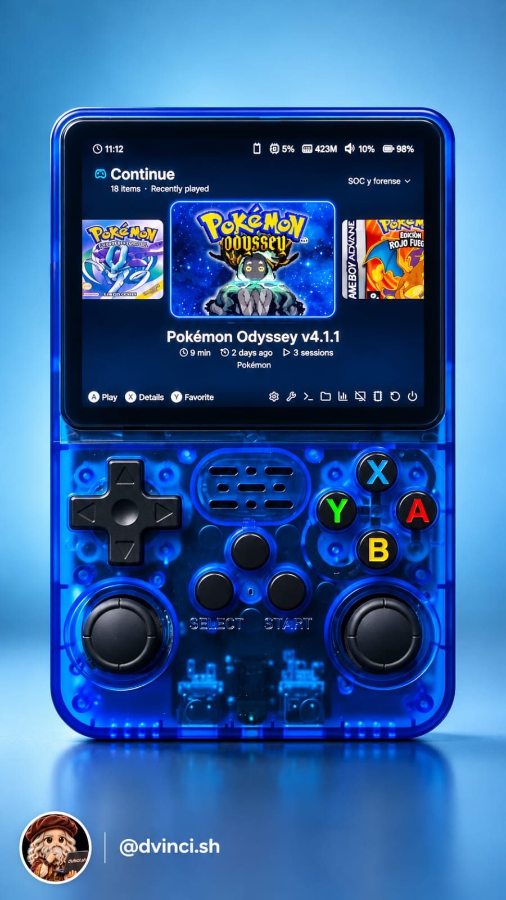
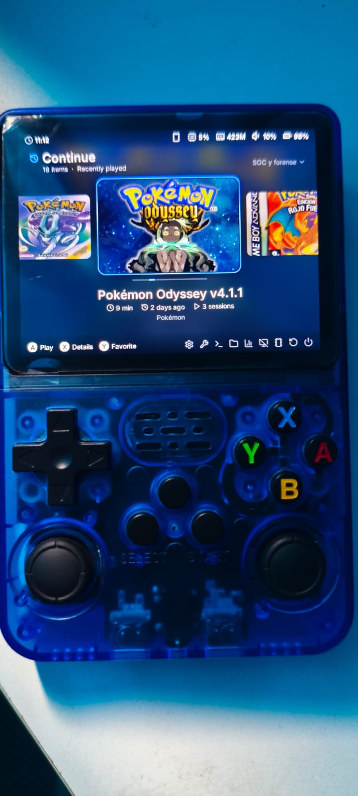
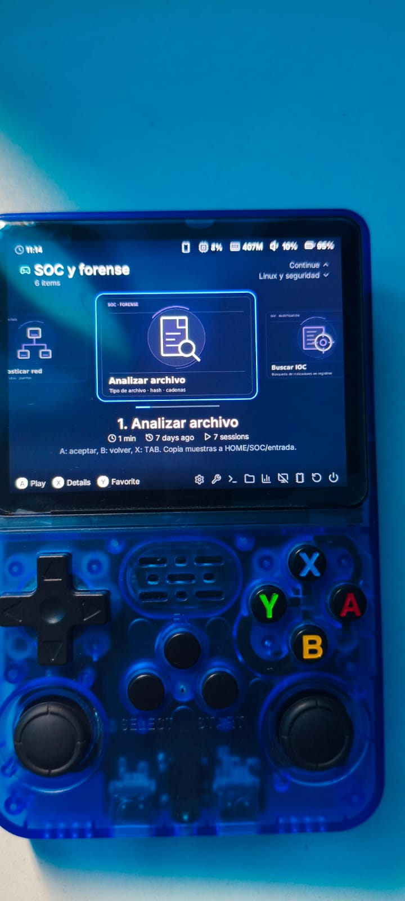
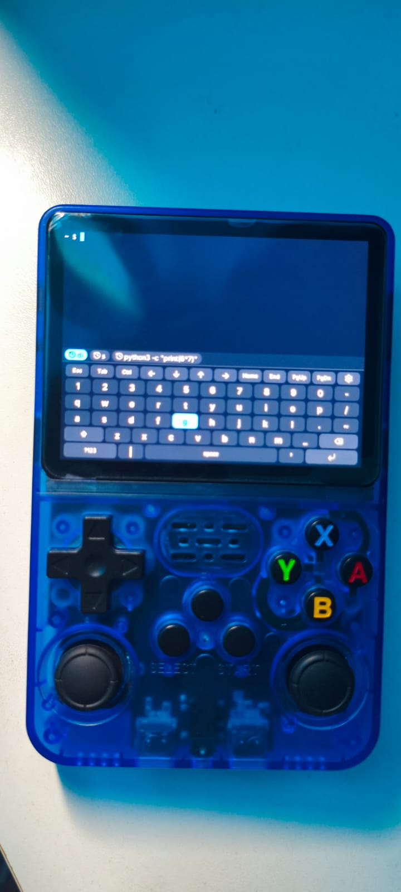
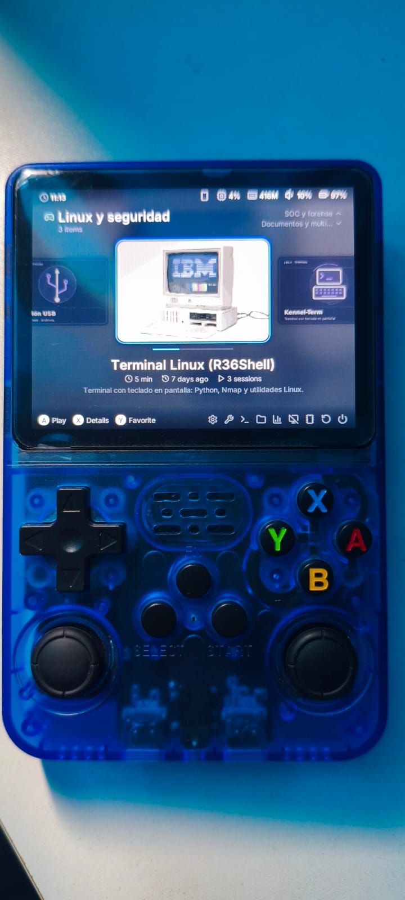
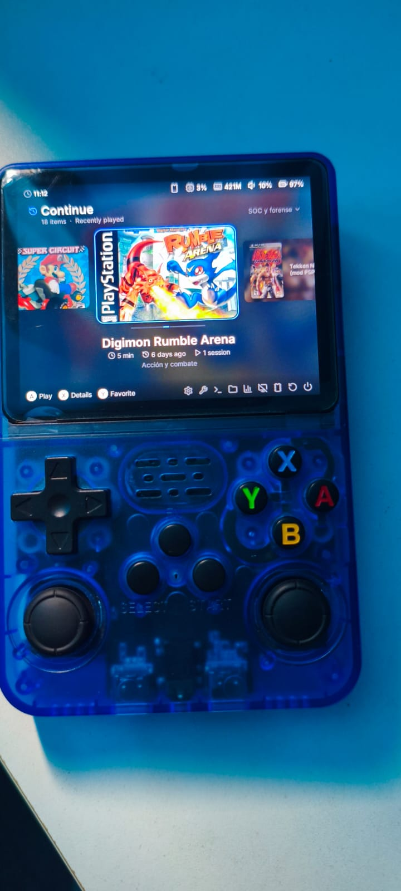
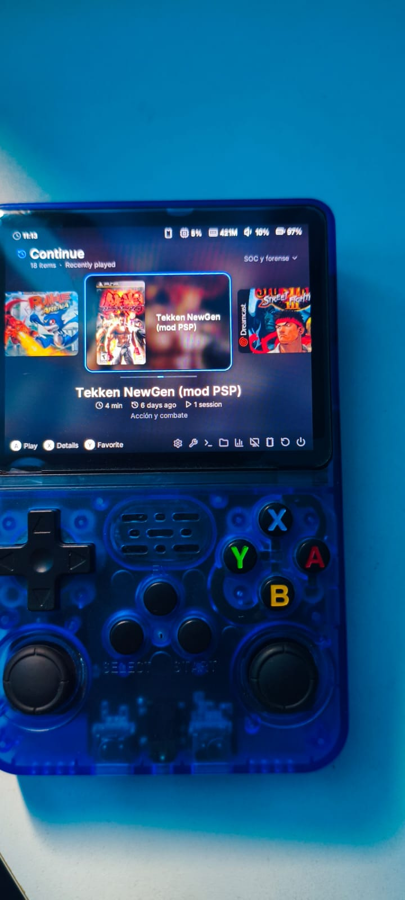

<div align="center">

# R36S MOD

**De consola retro a laboratorio Linux de bolsillo.**

Juegos · Terminal con teclado · SOC y forense · Música · Lectura

[Empezar](docs/INSTALACION.md) · [Compatibilidad](#antes-de-empezar) · [Fotos](#así-quedó) · [Qué incluye](#qué-puedes-instalar) · [Historia](docs/HISTORIA.md)



*Proyecto personal de [Andersson Espinoza](https://github.com/AnderssonEspinoza) · @dvinci.sh*

</div>

Una R36S puede servir para jugar, practicar Python, trabajar desde una terminal, leer apuntes y analizar archivos. Este repositorio reúne la experiencia de transformar nuestra consola y publica una **base modular con código revisable, diagnóstico previo y restauración** para equipos compatibles.

La interfaz de las fotos es **[Kennel](https://github.com/rincewindcz/kennel)**, sobre **[goodluckOS](https://github.com/CodeZombie/goodluckOS)**. Sus autores hicieron el firmware y el launcher; aquí compartimos nuestra integración, ajustes y documentación. No es una imagen de firmware ni una distribución de juegos.

> **Estado: versión inicial para revisión comunitaria.** Los cambios originales se probaron en nuestra consola. El instalador público es una implementación nueva: tiene pruebas automatizadas, pero todavía no una instalación integral en otra consola ni una nueva validación física de este paquete. No prometemos compatibilidad universal ni cero pérdida de datos.

## Antes de empezar

**El nombre R36S no identifica por sí solo el hardware.** Nuestra unidad es una **GA36-MB / Allwinner A33, ARM32, ~512 MB RAM y pantalla 640 × 480**. Otras R36S utilizan RK3326 y necesitan otra ruta.

| Tu equipo | Ruta |
|---|---|
| GA36-MB A33, goodluckOS y sistema de archivos compatible | Puedes revisar y probar este perfil |
| RK3326, ArkOS real, ROCKNIX, aarch64 | **No aplicar** el instalador de este repositorio |
| No sabes qué placa o panel tienes | Primero usa el [identificador/builder oficial de goodluckOS](https://codezombie.github.io/goodluckOS/download.html) |

El instalador **no flashea, no particiona y no repara microSDs**. Conserva las rutas existentes de partidas, rechaza placas y supervisores desconocidos y no modifica TF2. Antes de cambiar un sistema, haz una copia externa de tus partidas y de la tarjeta original.

## Así quedó

<table>
<tr>
<td align="center"><a href="assets/photos/pokemon.png"></a><br><b>Tu biblioteca con carátulas</b></td>
<td align="center"><a href="assets/photos/soc.png"></a><br><b>SOC y forense</b></td>
<td align="center"><a href="assets/photos/terminal.png"></a><br><b>Terminal con teclado</b></td>
</tr>
<tr>
<td align="center"><a href="assets/photos/linux.png"></a><br><b>Linux portátil</b></td>
<td align="center"><a href="assets/photos/digimon.png"></a><br><b>Clásicos de tu colección</b></td>
<td align="center"><a href="assets/photos/tekken.png"></a><br><b>Perfiles por juego</b></td>
</tr>
</table>

Las seis fotos de la galería documentan nuestra consola. La portada principal es una imagen promocional proporcionada por el autor. **Ver un juego en el menú no demuestra que funcione fluido.** Las portadas comerciales aparecen en las fotos; las ROMs y los archivos originales de esas carátulas no se distribuyen.

## Qué puedes instalar

| Componente | Incluido aquí | Cómo se obtiene |
|---|---|---|
| Firmware goodluckOS | Guía y enlace oficial | Builder oficial, en una SD aparte |
| Kennel, lector y terminal | Guía de instalación | Release oficial de Kennel |
| Python y herramientas ARM32 | Constructor del toolkit con APT autenticado | Se descargan paquetes Debian en tu laptop, sin instalarlos allí |
| Protección de guardados | Módulo `saves` | Autosave, cierre ordenado, HOME síncrona y copias versionadas |
| Rendimiento automático | Módulo `performance` | Gobernador performance y máximo GPU ya disponible en el kernel |
| Laboratorio SOC | Módulo `soc` | Menú nuevo para archivos, IOC, PCAP, hashes y firmas de firmware |
| Música con kew | Guía y configuración de referencia | Proyecto oficial; compilación ARM no empaquetada aquí |
| Emulación y homebrew | Guía y enlaces a autores | Añade tus archivos; no se incluyen ROMs ni BIOS |
| NOVA, Wi-Fi y red USB personalizada | Historia y estado | Sin instalador público en esta versión |

**La galería muestra la configuración personal completa.** Clonar este repositorio no copia nuestros juegos, favoritos, estadísticas o diseños particulares. Los módulos públicos se añaden a un goodluckOS compatible ya instalado.

## Inicio rápido

**1. En una laptop Linux, clona el proyecto:**

```bash
git clone https://github.com/AnderssonEspinoza/r36s-mod.git
cd r36s-mod
```

**2. Prepara la consola siguiendo [Instalación paso a paso](docs/INSTALACION.md):** identifica la placa, respalda tus datos, instala goodluckOS y Kennel desde sus autores y prepara Python con el [constructor del toolkit](docs/TOOLKIT.md).

**3. Copia esta carpeta a `HOME/ports/r36s-mod`. En la terminal de la consola:**

```sh
cd /home/player/ports/r36s-mod
sh install.sh doctor
sh install.sh plan
```

Ambos comandos solo leen y muestran información. Si la comprobación pasa, revisa los archivos anunciados. Para instalar, **desde una sesión root de la consola**, con los juegos cerrados:

```sh
sh install.sh apply
```

Apaga desde el menú y vuelve a encender. No hay reinicio automático ni descarga/ejecución de un script remoto. Puedes elegir módulos: `sh install.sh apply --modules saves performance`.

> Si `appctl` ya está modificado, el instalador se detiene. No reemplaces el supervisor ni uses una opción para saltarte la comprobación: revisa [la guía](docs/INSTALACION.md#si-el-instalador-se-detiene).

## Partidas: lo que sí hace la protección

- Autosave de RetroArch cada tres segundos, preservando tus directorios actuales.
- Cierre que deja escribir a RetroArch antes de finalizar sus procesos padres.
- Escritura síncrona de HOME tras el siguiente arranque.
- Copias en ext4 de guardados pequeños: primera versión válida, última y tres anteriores.
- Restauración al iniciar si el archivo desapareció o quedó totalmente vacío/`FF`/`00` y existe una copia válida.

**No recupera automáticamente partidas ya perdidas**, no valida la estructura de todos los formatos y no sustituye un respaldo externo. La FAT y el respaldo ext4 están en **la misma microSD**. Un archivo no vacío pero corrupto requiere revisión manual.

En nuestro caso hubo corrupción de FAT y **no recuperamos los avances antiguos de Pokémon**. Después de reparar, una ROM de prueba FLASH128K conservó ambos bancos tras apagar completamente y encender. Ese resultado pertenece a la intervención original, no a una prueba física de este nuevo instalador. [Detalles y comprobación](docs/GUARDADOS.md).

## Rendimiento sin promesas imposibles

El módulo selecciona frecuencias que el kernel ya ofrece; no añade overclock. En nuestra consola se usaron CPU 1,2 GHz y GPU 384 MHz. Restaura los valores anteriores al regresar al menú. Puede aumentar consumo y temperatura.

Las opciones de PSP están documentadas como referencia, no aplicadas a todos los juegos. **No confirmamos fluidez constante en combate de God of War**, ni rendimiento de ArkOS real sobre este hardware distinto. [Perfiles y límites](docs/JUEGOS-Y-MULTIMEDIA.md).

## Deshacer cambios

Cada instalación guarda originales y un manifiesto privado en `/var/lib/r36s-mod/backups/FECHA-PID`.

```sh
sh install.sh restore --backup /var/lib/r36s-mod/backups/FECHA-PID
```

Usa la ruta exacta devuelta por `apply`, desde root y sin juegos abiertos. Si editaste después uno de los archivos, se detiene para conservar tu cambio. No borra partidas ni copias. Apaga desde el menú y vuelve a encender. [Recuperación](docs/GUARDADOS.md).

## Verificación y colaboración

```bash
python3 -m unittest discover -s tests -v
sh -n install.sh
python3 scripts/build-toolkit.py            # solo muestra el plan
```

Las pruebas cubren rechazo de hardware incorrecto, rutas simbólicas, archivos de configuración, restauración, rollback y copias FLASH128K. CI ejecuta las pruebas y revisa el contenido público. Se agradecen pruebas en hardware con placa, firmware, módulo, resultado y datos personales ocultos.

No subas dumps, ROMs, BIOS, partidas, capturas PCAP personales, contraseñas o credenciales a un issue. Para fallos de seguridad usa [SECURITY.md](SECURITY.md).

## Documentación

- [Instalación y compatibilidad](docs/INSTALACION.md)
- [Toolkit ARM32: construcción y transferencia](docs/TOOLKIT.md)
- [Guardados, validación y recuperación](docs/GUARDADOS.md)
- [Juegos, kew, vídeo, lectura e internet](docs/JUEGOS-Y-MULTIMEDIA.md)
- [Historia del trabajo y pendientes reales](docs/HISTORIA.md)
- [Qué se publica y qué se excluye](docs/PRIVACIDAD.md)
- [Autores, licencias y referencias verificadas](THIRD_PARTY.md)

Código propio: **GPL-2.0-or-later**. Fotos y marcas: ver [ASSETS.md](ASSETS.md). No hay afiliación oficial con los fabricantes ni con los proyectos citados.
